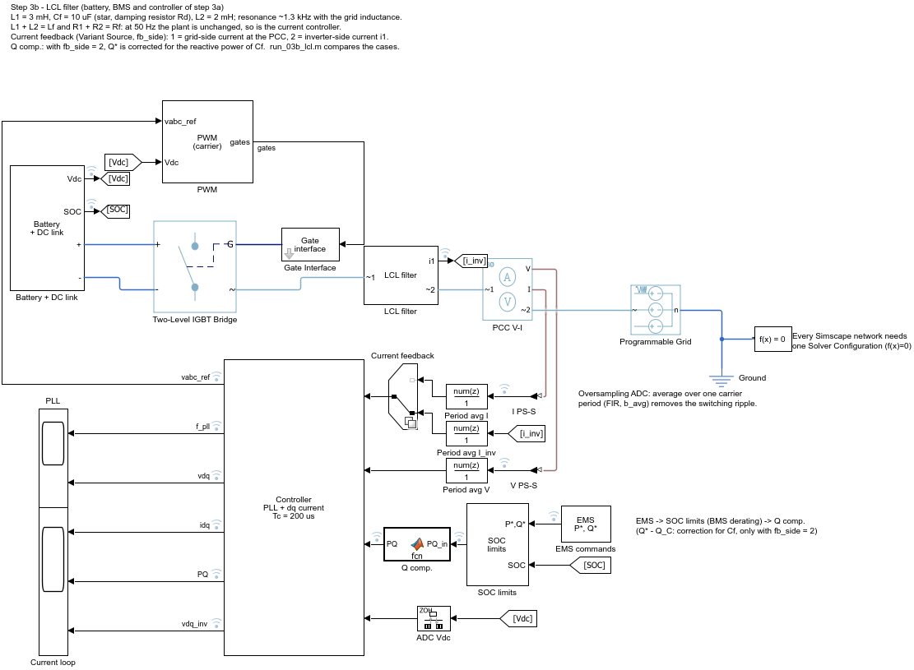
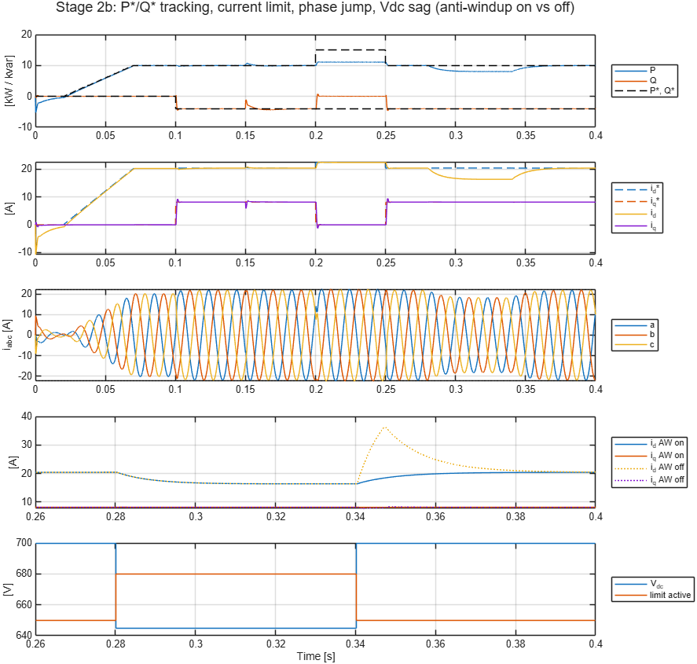
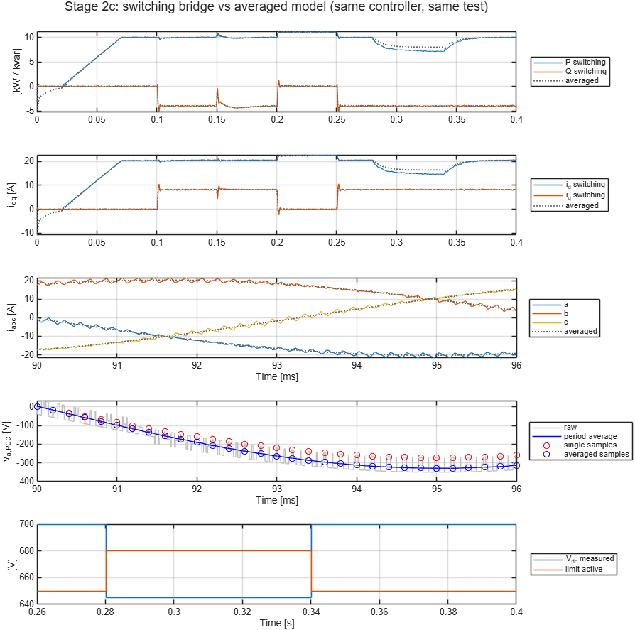
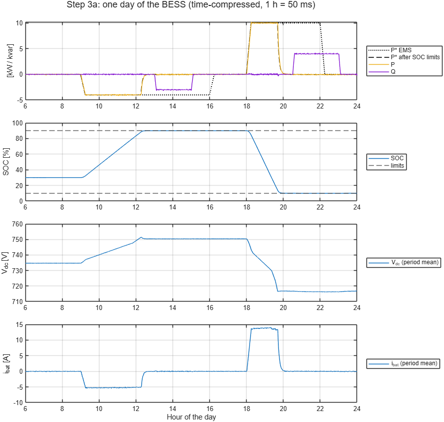
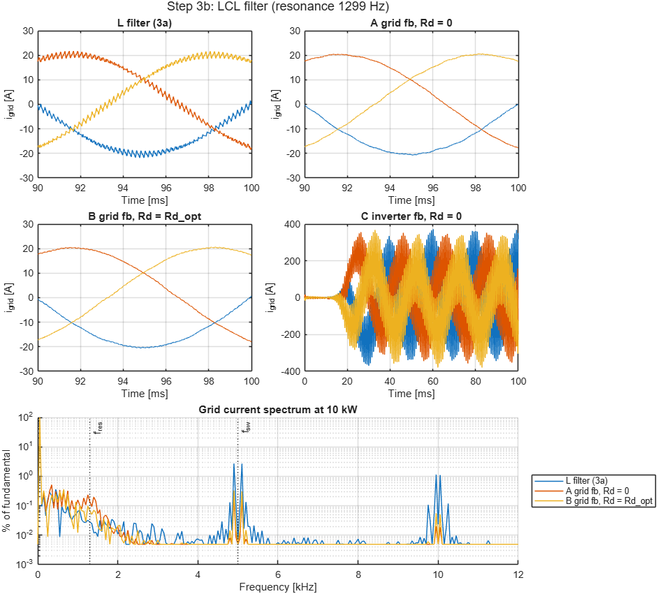
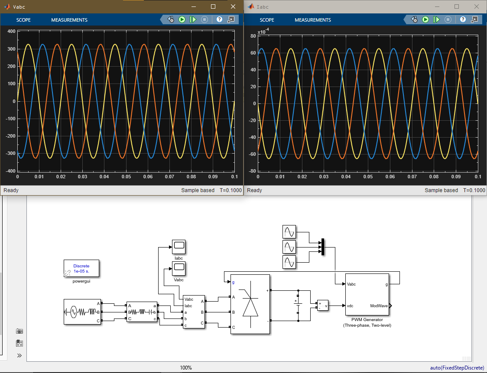

# Grid-Tied Battery VSC Inverter | Simulink

A step-by-step Simulink / Simscape Electrical model of a **10 kW grid-tied battery energy storage system (BESS)**, built for teaching: every step adds one idea to the previous model, and every step comes with a script that runs it and prints what it shows.

## Project

- 10 kW, 400 V / 50 Hz grid, two-level IGBT inverter switching at 5 kHz
- Battery directly on the DC link (224 LFP cells in series, 28 Ah, ~20 kWh, 717–750 V between 10 and 90 % SOC)
- Grid-following control: SRF-PLL and dq current control at Tc = 200 µs
- An EMS sends P* and Q* (P > 0 discharges into the grid, P < 0 charges); the inverter delivers them within its current limit (1.1 pu) and the SOC limits of the BMS (10–90 %)

## Steps

| Step | Folder / model | What it adds | Main result |
|---|---|---|---|
| 1 | `01_open_loop/vsi_01_open_loop` | Switching bridge, L filter, grid; references computed from a phasor model | 9.96 kW for 10 kW requested, but nothing corrects drift |
| 2a | `02_current_control/vsi_02a_avg_pll` | Averaged inverter, SRF-PLL | PLL locks; a 10° phase jump settles in 31 ms |
| 2b | `02_current_control/vsi_02b_current_ctrl` | dq PI current control, decoupling, current limit, voltage limit, anti-windup | P and Q follow the EMS; anti-windup cuts the peak current after saturation from 37 A to 22 A |
| 2c | `02_current_control/vsi_02c_switching` | Same controller on the switching bridge: carrier PWM, oversampled (period-average) measurements | Same P/Q as the averaged model; THD 4.3 % |
| 3a | `03_battery/vsi_03a_battery` | Battery (Table-Based) + DC-link capacitor, BMS SOC, SOC limits, one day of EMS operation (time-compressed) | SOC held within 10–90 %; Q delivered with a full or empty battery; 96.8 % efficiency at 10 kW |
| 3b | `03_battery/vsi_03b_lcl` | LCL filter, damping, grid- vs inverter-side current feedback (Variant Source), Q compensation | THD 4.3 % → 0.9 % |

Each folder holds, per step:

| File | Purpose |
|---|---|
| `build_XX_*.m` | Builds the model from scratch (later steps copy blocks from or Save-As the previous model) |
| `params_XX_*.m` | All parameters, with the reasoning behind them; loaded by the model's `PostLoadFcn` / `InitFcn` |
| `run_XX_*.m` | Runs the test, prints a results table and plots the figure |
| `vsi_XX_*.slx` | The built model |

To try a step, open MATLAB in its folder and run its `run_` script; the model can also be opened and simulated directly.

## Results

### Step 2b: current control

P*/Q* steps, a +10° grid phase jump, a request above the current limit and a DC-link sag below what the inverter needs, with and without anti-windup.

| Event | P [kW] | Q [kvar] |
|---|---|---|
| P* = 10 kW | 9.99 | +0.01 |
| Q* = −4 kvar | 10.01 | −3.98 |
| After the phase jump | 10.00 | −4.02 |
| P* = 15 kW (current limit) | 11.07 | +0.03 |
| Vdc = 645 V (voltage limit) | 8.02 | −3.98 |

### Step 2c: switching model

The stage 2b controller drives the IGBT bridge unchanged (only the delay compensation goes from 1.5 to 2 Tc).

- A single sample on the carrier peak always falls in the zero vector and reads ~5/6 of the PCC voltage; P stays at 9.3 kW. Averaging the samples over one carrier period (oversampling ADC) fixes it: 10.01 kW.
- A first-order RC anti-aliasing filter, sampled only on the carrier peaks, left a 3.6 % second harmonic in the current.
- Current THD at 10 kW: 4.3 % (low order 0.7 %, switching band 4.3 %).

### Step 3a: battery, one day of operation

06:00–24:00, compressed to 0.9 s (1 h = 50 ms, battery capacity scaled by the same factor). The EMS charges 4 kW around midday and discharges 10 kW in the evening. Both requests exceed the usable energy on purpose.

| Hour | Situation | P* EMS | P* after SOC limits | P | Q | SOC |
|---|---|---|---|---|---|---|
| 10:00 | charging | −4.00 | −4.00 | −4.00 | 0.00 | 50.8 % |
| 13:30 | full, Q* = −3 kvar | −4.00 | −0.03 | −0.03 | −2.99 | 90.0 % |
| 18:45 | discharging | 10.00 | 10.00 | 10.01 | −0.01 | 47.9 % |
| 21:00 | empty, Q* = +4 kvar | 10.00 | −0.05 | −0.04 | +3.99 | 9.9 % |

- Reactive power needs no stored energy: Q* is delivered with a full or an empty battery.
- Below 10 % / above 90 % SOC the BMS curves force a small charge / discharge, otherwise the inverter losses and the Q exchange keep draining an empty battery.
- Time compression has a side effect: the battery voltage falls 72000× faster than in reality, so the DC-link capacitor releases C·dV/dt (~200 W). The run script separates it from the energy balance.

### Step 3b: LCL filter

L1 = 3 mH, Cf = 10 µF (star), L2 = 2 mH; with the grid inductance the resonance is at 1.3 kHz. L1 + L2 equals the former L filter, so the current controller is unchanged.

| Case | P / Q at 10 kW | Q at Q* = −4 kvar | THD |
|---|---|---|---|
| L filter (step 3a) | 10.00 / 0.00 | −4.00 | 4.3 % |
| Grid-side current feedback, no damping | 10.01 / 0.00 | −4.01 | 1.0 % |
| Grid-side current feedback, Rd = 4.1 Ω (default) | 10.00 / 0.00 | −4.00 | 0.9 % |
| Inverter-side current feedback, no damping | unstable (380 A) | — | — |
| Inverter-side feedback, Rd, no Q compensation | 10.02 / +0.52 | −3.50 | 0.9 % |
| Inverter-side feedback, Rd, Q compensation | 10.01 / +0.01 | −3.99 | 0.9 % |

- With a loop delay of 2 Tc the critical frequency is 1/(8 Tc) = 625 Hz. The resonance lies above it, so grid-side current feedback is stable even without damping, and inverter-side feedback is not. Below the critical frequency it would be the other way round.
- The damping resistor costs 27 W (0.27 %).
- With inverter-side feedback the filter capacitor adds its reactive power (~0.5 kvar) at the PCC; lowering Q* by that amount compensates it. Grid-side feedback needs no compensation.

## Modelling notes

- Fixed-step discrete solver, Ts = 1 µs for the switching models; the controller runs at Tc = 200 µs (one carrier period).
- Simscape networks use the partitioning local solver (about 20× faster than Backward Euler here); the LCL model needs `PartitionMethod = MERGE`.
- Simscape logging is off (`SimscapeLogType = none`); the signals of interest are logged with signal logging.

## Original open-loop models

`dc_fed_grid_connected_vsi_open_loop.slx` (Specialized Power Systems) and `dc_fed_grid_connected_vsi_open_loop_simscape2026.slx` (converted to Simscape Electrical) are the starting point of the project. Step 1 rebuilds the same circuit with native Simscape Electrical blocks.

## Possible next steps

- Grid support: Q(V) and P(f) droop
- A PV array with a DC-DC converter and a DC-link voltage loop
- Grid-forming / islanded operation
- Dead time, SVPWM

## Tools

MATLAB and Simulink R2026a with Simscape and Simscape Electrical.
